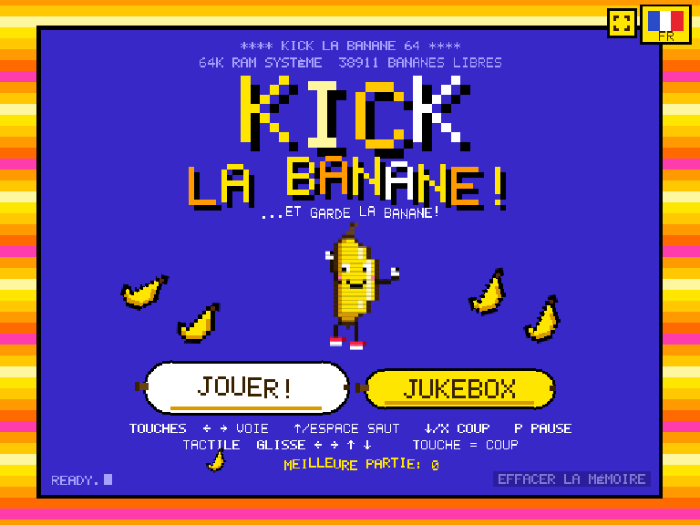
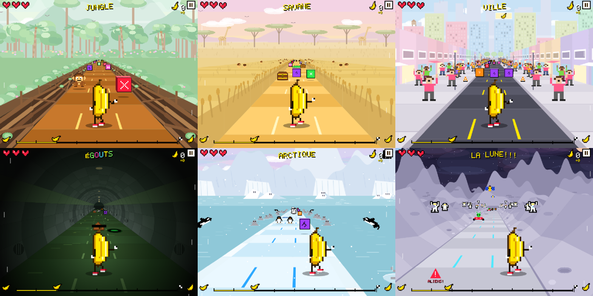
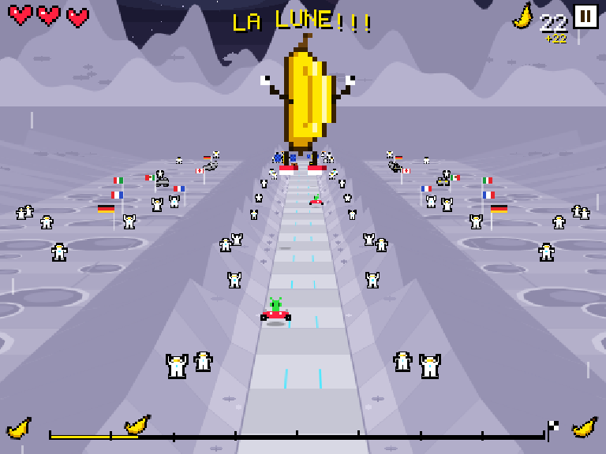
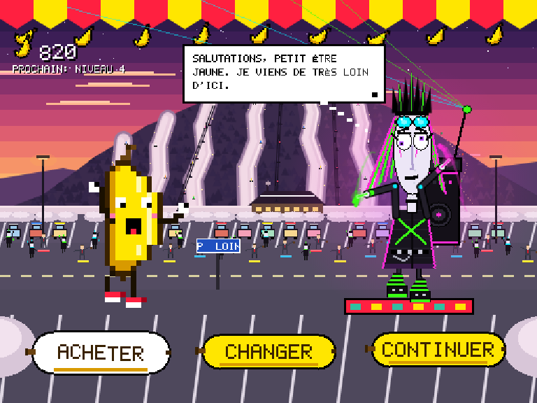
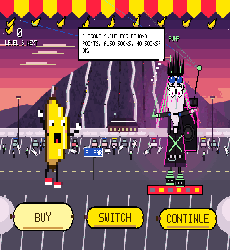
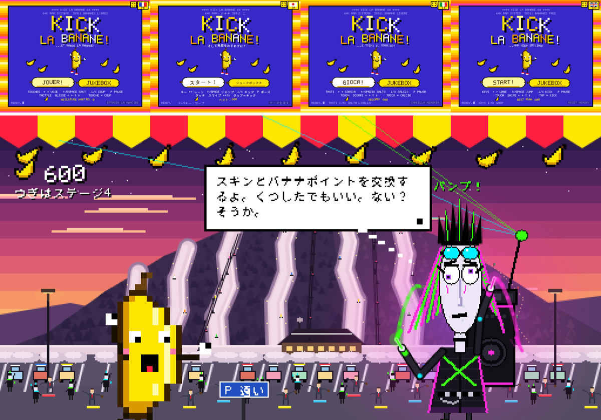
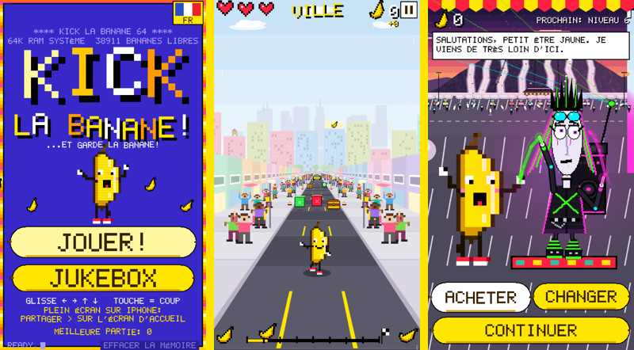

# KICK LA BANANE !

*…et garde la banane !*

A retro, Commodore‑64‑flavoured corridor runner where you play a banana with legs, kicking your way through seven worlds. Bright yellow everywhere, everything dances to the beat, and the whole thing is **one HTML file** you can open in any browser, on a computer, phone or iPad.

  

  

---

## Play it

There's nothing to install and no build step.

1. Download **[`kick-la-banane.html`](kick-la-banane.html)** (or clone the repo).
2. Open it in a modern browser: Chrome, Firefox, Safari or Edge.
3. Click or tap once so the browser lets the music start, then press **JOUER !** (or **START!** in English).

If GitHub Pages is turned on for this repo, `index.html` redirects to the game, so the repo's Pages URL is playable directly.

**On a phone or tablet**, the game fills the whole screen held upright or sideways.
- **iPad and Android:** use the ⛶ button on the title screen for fullscreen.
- **iPhone:** Safari doesn't allow web pages to go fullscreen, so use **Share → Add to Home Screen** and launch it from there. It then runs fullscreen like an app.

**Offline:** the game runs fully offline. The only network request is the optional Japanese pixel font (DotGothic16 from Google Fonts). Without it, Japanese falls back to your device's own Japanese font.

**Saving:** your bought skins, best run, unlocked levels, language and sound settings are saved in your browser's `localStorage`. The title screen has a small **RESET MEMORY** button (tap it twice) that wipes everything for a fresh start.

### Controls

| Action | Keyboard | Touch |
|---|---|---|
| Change lane | ← → (or A / D) | Swipe left / right |
| Jump | ↑, W or Space | Swipe up |
| Kick | ↓, X, K or J | Tap anywhere |
| Slam down from the air (counts as a kick) | ↓ while in the air | Swipe down while in the air |
| Pause | P or Esc | ⏸ button, top right |
| Mute everything | M | — |

The pause menu can switch on a strip of big **← → ↑ KICK** buttons along the bottom, for anyone who prefers buttons to swipes. Once you've reached a level, keys **1–7** on the title screen jump straight to it.

---

## The game

You're a banana running down a yellow corridor. The level moves you forward on its own and speeds up as you go. Your job is to dodge, jump and **kick**. You can kick just about anything, but some things are better left alone.

### Blocks

The blocks hover a little above the ground. Running through a block normally does nothing, except for red and yellow ones.

| Block | Kick it | Run into it |
|---|---|---|
| 🟥 **Red** | **–1 heart** | –½ heart |
| 🟨 **Yellow** (immovable) | –½ heart, and you get bounced to another lane | –½ heart, bounced |
| 🟩 **Green** | Explodes 💥 | nothing |
| 🩷 **Pink** | Pops and pushes you into another lane | nothing |
| 🟧 **Orange** | Flies into the camera and splats; you're dizzy for 0.5 s | nothing |
| 🟪 **Purple** | Crumbles; you fall and roll for 1 s (no kicking, but you pass through blocks; holes and obstacles still get you) | nothing |

**Old chests** must be kicked open. Each one holds a power‑up:
- **Invincibility** (10 s): you turn into a sparkling rainbow and nothing can hurt you. Kicked blocks just smash, with no push, dizziness or fall.
- **Irish Dancing** (10 s): you turn green, put on a little hat and kick automatically at 5× speed.
- **+1 Heart:** you glow gold for a second while you digest it.

### Hearts, points and dying

You start each level with **3 hearts**. Obstacles, animals and holes cost ½ heart.

**Banana points** come from kicking things and jumping over danger. Each level is tuned so that a perfect run buys roughly one skin, with a little left over.

If you lose all your hearts, the level **rewinds to the start** (or to the start of the current zone in the last level). You lose that level's points but keep your bank, and you get 1 second of invincibility. There's no game over; you just try again.

Points last for one run. They're spent at the merchant between levels and reset when you quit or finish the game. Your best run is remembered on the title screen.

### The seven levels

| # | World | Watch out for | Music |
|---|---|---|---|
| 1 | **Jungle**: tangled‑branch walls | holes, charging monkeys, fallen trees | *Cumbia de la Selva* (cumbia) |
| 2 | **Savannah**: wheat fields with meerkats hiding in them | lions, zig‑zagging gazelles, sleeping or wandering crocodiles | *Samba do Leão* (samba batucada) |
| 3 | **City**: sidewalks full of cheering people | open manholes, taxis that you can't jump over | *Salsa del Taxi* (salsa) |
| 4 | **Sewers**: a dark round tunnel and a river of green sludge | rats, sinkholes, censored piles of *something* | *Tango de las Ratas* (tango) |
| 5 | **Arctic**: a floating ice floe, with seals and orcas cheering you on | ice holes, sliding penguins, polar bears, snowmen. Ice is slippery, and **every landing makes you twirl for 1 s** | *Bossa Polar* (bossa nova) |
| 6 | **The Moon!!!**: a valley of craters, with rovers, flags and astronauts cheering | craters, alien buggies **coming from behind**, satellites in the sky. **Jumps go 6× higher** | *Reggaetón Lunar* (reggaeton) |
| 7 | **Last level**: all six worlds in order, twice as long, with a short breather (and +1 heart) between each zone | everything | each world's song, plus a conga break in the breathers |

  

### The merchant

Between levels you meet a very tall, very strange cyber‑goth merchant "from far from here", dancing in the parking lot of Mont Saint‑Sauveur at sunset. A themed crowd of costumed skiers and snowboarders changes after each level. You can:
- **BUY** skins: Rotten, Green, Red, Orange, Checkered and the very expensive Golden.
- **SWITCH** to a skin you already own.
- **CONTINUE** to the next level.

On the title screen, tapping the banana cycles through the skins you own.

  
  

### Languages

**Français** (default), **日本語**, **Italiano** and **English**. Switch with the flag button at the top right of the title screen.

### Music

There are eight original Latin‑inspired songs plus jingles, all synthesized live with the Web Audio API; there are no audio files. You can listen to all of them from the **JUKEBOX** on the title screen. Music keeps playing while you're paused.

---

## Phones & tablets

When held upright, the game switches to a tall layout: a finer canvas, a slightly higher camera so you can see what's coming over the banana's head, and the main buttons placed within reach of your thumb.

---

## Under the hood

- **Single file:** about 3,000 lines of plain JavaScript, HTML and CSS in [`kick-la-banane.html`](kick-la-banane.html). It has no dependencies, frameworks or build step, and every graphic is drawn in code.
- **The design write‑up**, covering the shape of the game, the levels and what each one is going for, is in **[docs/DESIGN.md](docs/DESIGN.md)**.
- **Contributing:** see **[CONTRIBUTING.md](CONTRIBUTING.md)**.

## Credits

- **Design and direction:** Francis ([@u269c](https://github.com/u269c)). Built iteratively with Claude (Anthropic) as a pair-programmer.
- **Music engine:** reused and extended from Francis's earlier game, [BlocSauteur](https://github.com/u269c/BlocSauteur).
- **Japanese pixel font:** [DotGothic16](https://fonts.google.com/specimen/DotGothic16) by Fontworks, under the SIL Open Font License, loaded from Google Fonts.

## License

[Apache License 2.0](LICENSE).
